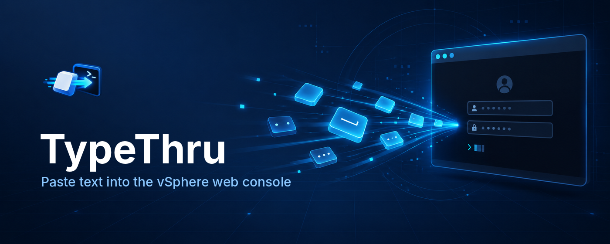
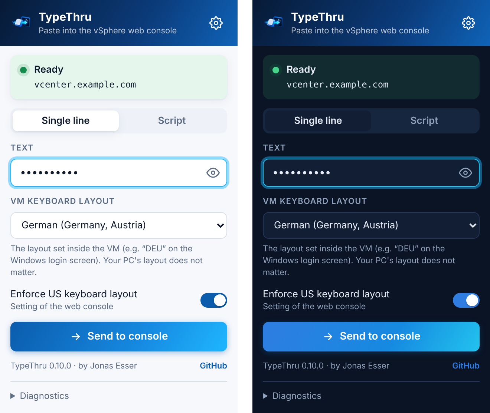
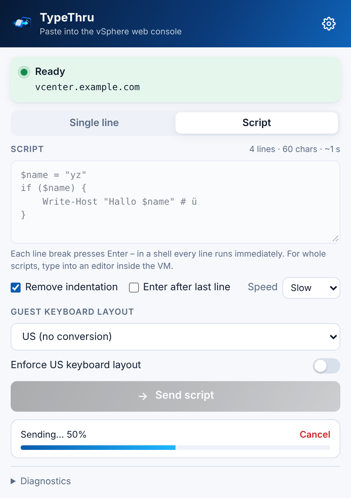

<p align="center">
  
</p>

#  TypeThru

**Paste text into the vSphere web console.**

[](https://github.com/jonasesser/typethru/actions/workflows/ci.yml)

The vSphere HTML5 web console has no clipboard support for the guest. TypeThru is a
small browser extension that sends text to the console as keystrokes, so you don't
have to type long passwords, commands or license keys by hand.

It also handles a common problem for non-US users: when the guest uses another
keyboard layout (German, Swiss German, French, UK, Spanish, Italian), it converts the
text so the right characters arrive.

> TypeThru is an independent project and is not affiliated with or endorsed by
> Broadcom or VMware. vSphere and vCenter are trademarks of their respective owners.

<p align="center"></p>

## Use cases

- Passwords on Windows and Linux login screens
- Commands and one-liners in a shell or PowerShell
- License and product keys during OS installation
- IP addresses, hostnames and domain-join details
- Recovery consoles and guests without VMware Tools

## Features

- Sends text to the web console as keystrokes
- Script mode for multi-line text with adjustable speed, progress and cancel
- Correct characters for German, Swiss German, French (AZERTY), UK, Spanish, Italian and US guests – including AltGr characters such as `@ { } [ ] \ |`
- Shows and switches the console's own "Enforce US Keyboard Layout" button
- Shows the target before sending, host allowlist in the options or via enterprise policy
- Minimal permissions, no network access, nothing stored
- Bookmarklet version for browsers where extensions cannot be installed

## Installation

### From the store

Chrome Web Store and Edge Add-ons releases are in preparation.

### From a release (Chrome / Edge)

1. Download `typethru-extension-<version>.zip` from the
   [latest release](https://github.com/jonasesser/typethru/releases/latest) and unzip it.
2. Open `chrome://extensions` or `edge://extensions` and turn on **Developer mode**.
3. Click **Load unpacked** and select the unzipped folder.
4. Optional: pin TypeThru to the toolbar.

Your organization may block unpacked extensions. In that case use the bookmarklet or
ask your administrator.

### Bookmarklet

If your browser does not allow extensions, download
`typethru-bookmarklet-<version>.html` from the
[latest release](https://github.com/jonasesser/typethru/releases/latest), open it in
the browser and drag the button for your guest layout onto the favorites bar. See
[Bookmarklet](#bookmarklet-1) below.

### From source

See [Development](#development).

## Usage

1. Open the VM with **Launch Web Console** and click once into the console.
2. Click the TypeThru icon or press **Ctrl+Shift+Y**.
3. Check that the **Target** line shows your vCenter.
4. Enter the text and press **Enter** or click **Send**.
5. Click back into the console.

Test with a visible text field first (for example a text editor in the guest) before
sending a password.

### Scripts and multi-line text

<p align="center"></p>

Switch to **Script** in the popup to send PowerShell or shell scripts, configuration
snippets or any multi-line text:

- The text is sent line by line in small chunks. Choose **Fast**, **Normal** or
  **Slow** if the guest drops characters.
- A progress bar shows the state; **Cancel** stops after the current chunk. Sending
  continues if the popup closes, and the progress is shown again when you reopen it.
- **Remove indentation** strips leading spaces and tabs, for editors that indent on
  their own (PowerShell ISE, VS Code, vim).
- **Enter after last line** is off by default, so nothing runs by accident.
- **Ctrl+Enter** sends, **Tab** inserts a tab.

Every line break presses Enter. In a shell every line runs immediately, so for whole
scripts type into an editor inside the VM and save the file there.


## Keyboard layouts

Select the guest's layout under **Guest keyboard layout**. TypeThru types every
character as the physical key that produces it on that layout – with Shift or AltGr
where needed – so the guest receives exactly what you entered, including characters
like `@ € { [ ] } \ | ~ < >`. The selection is remembered.

| Layout | Notes |
|---|---|
| US | |
| German (Germany, Austria) | |
| Swiss German | |
| French (AZERTY) | |
| English (UK) | |
| Spanish | |
| Italian | |

Dead keys (for example `^`, `´`, `` ` ``, `¨`) are sent followed by a space so the
character itself appears.

Characters that are not on the selected keyboard at all (for example `é` on a German
keyboard) are rejected instead of being typed wrong. If **Caps Lock** is on inside the
guest, letters arrive with inverted case – turn it off before sending.

Layouts are defined as key tables in `src/extension/layout.ts`; new layouts are
welcome.

#### How it works

TypeThru sends raw scan codes through the console's own connection, the same way a
physical keyboard would. If a console does not offer this (older vSphere versions),
TypeThru falls back to the console's text input with layout conversion; AltGr
characters and the key next to left Shift are then not available and are rejected.

### Console layout button

The web console has its own **Enforce US Keyboard Layout** button. The popup checkbox
**Console: enforce US keyboard layout** shows its state and switches it for you.

## Configuration

### Allowed hosts

Open **Options** (link in the popup, or right-click the TypeThru icon → *Options*)
and enter your vCenter hosts, one per line:

```
vcenter.example.com
*.lab.example.com
```

`*.domain` matches all subdomains. An empty list (default) allows every host; the
popup always shows the target before sending. Restricting TypeThru to your own
hosts is recommended.

### Enterprise policy

Administrators can preset TypeThru for all users with Chrome or Edge policies
(`3rdparty` extension policy, for example via group policy, Intune or another MDM).
The schema is in [`src/extension/managed_schema.json`](src/extension/managed_schema.json).

| Policy | Type | Effect |
|---|---|---|
| `allowedHosts` | list of strings | Allowed hosts. When set, users cannot change the list. |
| `defaultLayout` | string | Preselected guest layout (`us`, `de`, `de-ch`, `fr`, `uk`, `es`, `it`) until the user picks one. |

Example for Windows (registry, Chrome; use `Microsoft\Edge` for Edge), replace
`<extension-id>` with the ID shown in the browser's extension page:

```
HKLM\Software\Policies\Google\Chrome\3rdparty\extensions\<extension-id>\policy\allowedHosts
    1 = "vcenter.example.com"
    2 = "*.lab.example.com"
HKLM\Software\Policies\Google\Chrome\3rdparty\extensions\<extension-id>\policy
    defaultLayout = "de"
```

Check the result under `chrome://policy` or `edge://policy`.

## Bookmarklet

The bookmarklet offers the core function without installing anything:

- Built from [`src/bookmarklet/typethru.ts`](src/bookmarklet/typethru.ts); it uses
  the same layout module as the extension
- One bookmarklet per guest layout
- The browser's input dialog shows the text in clear text
- No control of the console layout button

## Security

TypeThru needs only `activeTab`, `scripting` and `storage`, has no host permissions,
no network access, no background worker and never stores the text. Details, residual risks and
recommendations are in [SECURITY.md](SECURITY.md).

## Development

TypeThru is written in TypeScript and built with esbuild. Requires Node 20 or newer.

```
npm install
npm run build     # builds dist/extension, dist/bookmarklet, dist/tools
npm test          # unit tests
npm run check     # type check
```

After building, load `dist/extension` with **Load unpacked**. The bookmarklet install
page is `dist/bookmarklet/install.html`.

```
src/
  extension/      Browser extension (Manifest V3)
    manifest.json
    popup.html
    popup.ts      Popup logic
    page.ts       Functions injected into the console page
    layout.ts     Keyboard layout conversion
    wmks.ts       Types for the console widget
  bookmarklet/    Bookmarklet source
  tools/          DevTools scripts for diagnostics and manual tests
scripts/build.ts  Build script
assets/           Logo and banner
store/            Store listing texts, privacy policy and store graphics
test/             Unit tests and manual test matrix
```

Functions in `page.ts` are serialized and run inside the console page, so they must
stay self-contained (no imports other than types). The build does not minify the
extension, so the shipped code stays readable for review.

### Releases

Bump the version in `package.json` (the manifest version is taken from it), then tag:

```
git tag v0.10.0
git push origin v0.10.0
```

The release workflow checks, tests and builds the tag and attaches the extension zip,
the bookmarklet page and the DevTools tools to a GitHub release. CI runs the same
checks on every push and pull request.

### Manual tests

To try TypeThru in a real web console without installing the extension, paste the
DevTools test kit `dist/tools/typethru-console.js` into the console tab, see
[test/CONSOLE-TESTING.md](test/CONSOLE-TESTING.md).

Manual tests against a real console are described in
[test/MANUAL-TESTS.md](test/MANUAL-TESTS.md). After building, these scripts help with
troubleshooting (paste them into the DevTools console of the console tab):

- `dist/tools/console-diagnostics.js` reports where the console widget lives, its
  input methods and the layout button state. It does not type anything.
- `dist/tools/send-test-string.js` sends a test string to the guest without
  conversion.

## Troubleshooting

| Message | Cause / fix |
|---|---|
| No vSphere web console found in this tab. | Open the VM with **Launch Web Console** and use TypeThru in that tab. |
| More than one console found in this tab. | Open each console in its own tab. |
| Cannot access this tab | The browser blocks extensions on this page (for example `chrome://` pages). |
| Not supported with this layout | The text contains a character that cannot be typed with the selected guest layout. |
| Wrong characters in the guest | Select the guest's keyboard layout in the popup. |
| "Load unpacked" does nothing | Your browser may be managed by a policy that blocks unpacked extensions. Use the bookmarklet or ask your administrator. |

When reporting a problem, open **Diagnostics** at the bottom of the popup and copy
the report into the issue. It never contains the text you entered.

## Roadmap

- More layouts (Nordic, Belgian, …)
- Adjustable typing speed for slow guests
- Command snippets (never passwords)
- Chrome Web Store and Edge Add-ons releases

## License

[MIT](LICENSE)
